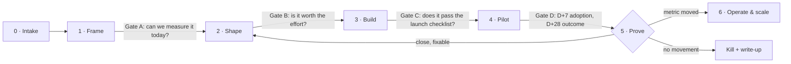

# Problem 3 · How every OKR ships with the highest chance of working

## The core idea

The brief describes a familiar failure: things get **built** but don't get **used** or don't **move the number**. That happens when "done" means shipped. In this system, **"done" means the success metric moved, or we made a written decision about why it didn't.** Everything below exists to make that rule cheap to follow.

Every piece of work is a **bet**, whether it's a feature, an automation, an analytics upload or a process change. Each bet goes through the same six stages. A gate between stages asks one question, and a bet can't pass the gate until that question is answered.

## The six stages

### 0 · Intake (anyone, 2 minutes)
A one-line ask goes into the ClickUp **Intake** list: *"Parents want to know if their kid studied this week."* Nothing more is needed at this stage. The PM triages Intake every Monday.

### 1 · Frame (PM, at most 2 days) → the one-page bet brief
| Field | Example: "Tonight's study block" on Home |
|---|---|
| Problem | 79% of students don't open the app on a given day; focus sessions are hidden behind a tab |
| For whom | Teen (primary), parent (sees result), advisor (uses data) |
| Evidence | Mixpanel: 11 tried focus, 5 regular; interviews W1 |
| **Success metric** (baseline → target, date) | Students with at least 1 completed focus session per weekday: 25% → 60% by 1 Jan |
| **Guardrail** (must not get worse) | Realm weekly actives ≥ 13; abandoned-session share ≤ 30% |
| **Kill criterion** | No pod above 40% after 3 pods have had it for 2 weeks |
| **Cognitive-load budget** | 1 tap to start; 0 typed inputs; 1 tap at the end |
| Owner | One name. Not "the team". |

**Gate A: can we measure the success metric today?** If not, the first slice of work is instrumentation, not the feature. Most failed launches are really launches nobody could measure.

### 2 · Shape (PM + designer + FSE, at most 3 days)
- **Flow sketch** on paper or in Figma: screens, the one primary action per screen, and the empty state.
- **Tracking plan:** every event and property the metric needs, written before code (e.g. `focus_session_started{planned_block_id, subject_id}`).
- **Data contract:** which table gets which row, and who or what writes it. Every input field must have a named consumer, a person or an automation that reads it. A field with no consumer gets cut.
- **Ops needs:** the SOP, who answers questions, and which alert fires if it breaks.
- **Effort:** S (≤3 days), M (≤2 weeks) or L (split it).

**Gate B: is it worth the effort?** Score = *(expected metric lift × confidence) ÷ effort days*. The top-scored bets fill each person's slots. **WIP limit: 2 active bets per person.** That rule forces finishing over starting.

### 3 · Build (time-boxed, 1–2 weeks)
- Ship in **vertical slices** that can be demoed every Wednesday, never a big reveal at the end.
- **Definition of done for build:** events fire in the Mixpanel live view, data lands in Supabase, the dashboard tile exists, the error path is handled, and the n8n workflow (if any) has an `errorWorkflow` and a heartbeat.
- If the time-box runs out, cut scope. Never extend the date.

### 4 · Pilot (1 pod, or advisors first)
**Gate C: launch checklist.** Tracking verified ✓ · dashboard tile live ✓ · SOP published in ClickUp Docs ✓ · advisors briefed with a 3-line script ✓ · rollback is a feature flag ✓ · review dates booked (D+7, D+28) ✓

Advisors use internal tools before students do (dogfooding). Student features roll out one pod per week (see the stepped-wedge design in `01_app_adoption.md`).

### 5 · Prove (D+7 adoption, D+28 outcome)
- **D+7:** are people using it? (reach, repeat use)
- **D+28:** did the success metric move? Did the guardrails hold?
- **The decision is written in the ClickUp task:** *Scale*, *Iterate* (back to Shape with what we learned) or *Kill*. A kill comes with three lines on what we learned. Killing things on schedule is how a 3-person team stays out of maintenance debt.

### 6 · Operate
Every bet that ships gets an owner, a health metric on the systems page, an alert, and a monthly check. If the monthly check shows the metric decaying, a new bet re-enters at Frame.

## Who does what (RACI)

| Activity | Me (PM / analytics lead) | Full-stack engineer | Process / systems designer |
|---|---|---|---|
| Intake triage, bet brief, success metric | **A/R** | C | C |
| Tracking plan, SQL metric definitions | **A/R** | R (implements events) | I |
| Flow and cognitive-load review | A | C | **R** (owns ops flows, ClickUp, SOPs) |
| Build: app, Supabase, n8n | A | **R** | C |
| ClickUp pipelines, SOPs, advisor and sales process | A | C | **R** |
| Launch checklist | **A** | R | R |
| D+7 / D+28 review and decision | **A/R** | C | C |
| Incident response (n8n alert) | I | **R** | R (for process breaks) |

## Rituals (total: under 2.5 hours a week for the team)

| When | What | Length | Output |
|---|---|---|---|
| Mon 10:00 | Planning: triage Intake, pick bets within WIP limits | 30 min | Statuses updated in ClickUp |
| Daily | Async stand-up as a ClickUp comment: done / next / blocked | 3 min each | Blockers surface without a meeting |
| Wed 16:00 | Demo: each live bet shows its slice running on real data | 30 min | Feedback while it is still cheap |
| Fri 16:00 | Metrics review: GTM tracker, progress board, bets due for D+7 / D+28 | 30 min | Decisions written on tasks |
| Monthly | OKR check-in with founders: bets scaled / killed, metrics vs target | 45 min | Re-prioritised bets |
| Quarterly | OKR setting: 3 objectives, at most 3 key results each | 2 hrs | The next quarter's bet list |

## ClickUp setup (the process designer builds this in week 1)

- **Space: Product & Systems**
  - List **Intake**: one-line asks.
  - List **Bets**, with statuses that are the stages (`frame → shape → build → pilot → prove → operate / killed`). The board view *is* the pipeline.
  - List **Incidents**: auto-filled by the `00_error_handler` n8n workflow.
- **Required custom fields on Bets:** Success metric · Baseline · Target · Target date · Guardrail · Kill criterion · Effort · Score · Owner · Decision.
- **ClickUp automations:**
  - Status → *pilot* creates two review subtasks, due D+7 and D+28, assigned to the PM.
  - Status → *build* is blocked unless the Success metric and Baseline fields are filled. This is Gate A, enforced by the tool rather than by memory.

## Cognitive-load rules for anything a teen or parent touches

1. One primary action per screen. If there are two, one of them is wrong.
2. A student types at most one free-text input per day; everything else is a tap with a pre-filled default.
3. Every input has a consumer (see Shape). We don't collect data "for later".
4. At most 2 notifications per student per day; parents hear from us weekly, not daily.
5. A new screen ships only if an old one gets removed or merged. The app's 25 features for 20 students is the result of not following this rule.

## Why this works for a three-person team

- **It is light.** One page per bet, three short meetings a week, and the gates are checkboxes in ClickUp, not documents.
- **It moves effort from building to proving.** About 30% of capacity is reserved for D+7 / D+28 work and for killing things, which is the part teams usually skip.
- **The same dashboards are the review agenda,** so analytics work and product work stay linked by default.
