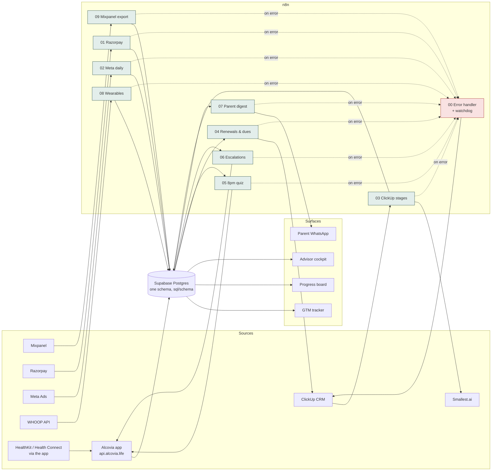

# Systems and data flow: "systems that don't break"

## Five rules every automation follows (enforced in `n8n/build_workflows.py`)

1. **No silent failure.** Every workflow names `00_error_handler` as its error workflow. That handler logs the failure to `sync_failures` and opens a ClickUp incident for the owner.
2. **No silent stop.** Scheduled jobs write a heartbeat to `sync_runs`. An hourly watchdog compares it with `sync_sla` and raises any job that missed its window, because a job that never runs never throws an error.
3. **Idempotent writes.** Every insert has a natural key (`payment_id`, `(lead_id, stage)`, `(date, ad_id)`, Mixpanel `$insert_id`) with `ON CONFLICT`. Retries and duplicate webhooks can't double-count revenue.
4. **Retries with backoff** on every external call: 3 tries, 5 seconds apart.
5. **Config lives in data, secrets in credentials.** Thresholds are in tables; API keys are in n8n credentials. Nothing sensitive sits in a node or in git.

## Why Supabase in the middle (and not ClickUp as the database)

ClickUp stays the **working tool**: sales moves leads through statuses, advisors get tasks. It is a poor **analytics store**: there are no joins, no history of status changes, and no way to combine it with Razorpay or Mixpanel. So each status change is copied into an append-only log in Postgres, and every dashboard reads from there. The team keeps working where it already works.

## Runbooks

| Alert | Likely cause | First action |
|---|---|---|
| `01 Razorpay` failed: *Bad signature* | Webhook secret rotated | Update `RAZORPAY_WEBHOOK_SECRET`; Razorpay retries automatically for 24h |
| `02 Meta` stale > 26h | Token expired (60-day long-lived token) | Refresh the system-user token; re-run for missed dates (the upsert makes this safe) |
| `03 ClickUp` failed: *Unmapped status* | Someone added a pipeline status | Add it to the map in the "Map status → stage" node; the process designer approves new statuses |
| `05 Quiz`: no quiz in the bank | Content not loaded | The content owner adds tomorrow's quiz; tonight is logged as `published = false`, so delivery % reflects it honestly |
| `08 Wearables` stale | WHOOP OAuth revoked by the student | The app shows a reconnect prompt (`whoop_reauth_required` already exists in the app) |
| Dashboards look wrong | Upstream job late | Check the "data through" date in the dashboard header against `sync_runs` |

## Weekly reconciliation (Friday metrics review, 5 min)

- Razorpay dashboard total for last week = `SUM(payments)` for last week
- Meta Ads Manager spend for last week = `SUM(ad_daily_metrics.spend_inr)`
- ClickUp count of leads created last week = `COUNT(leads)`

If any pair differs by more than 1%, that's an incident ticket, not a footnote.
